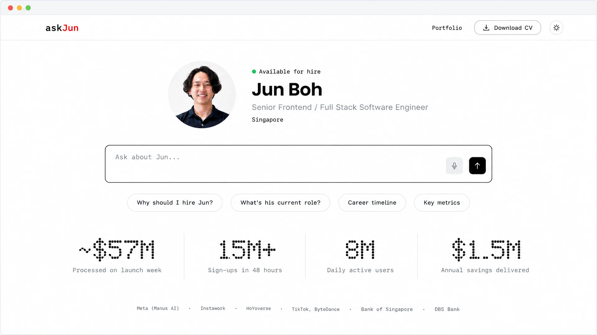
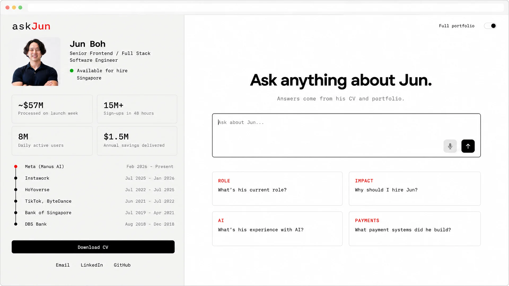
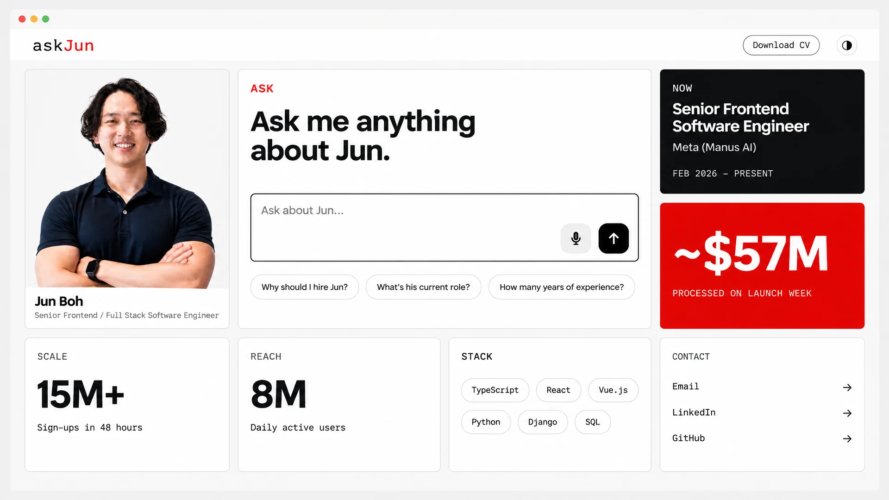
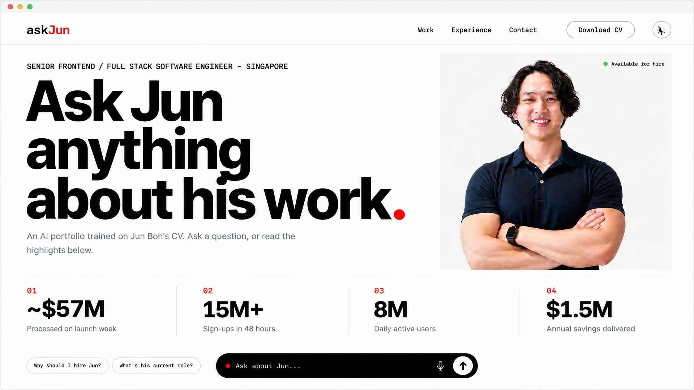
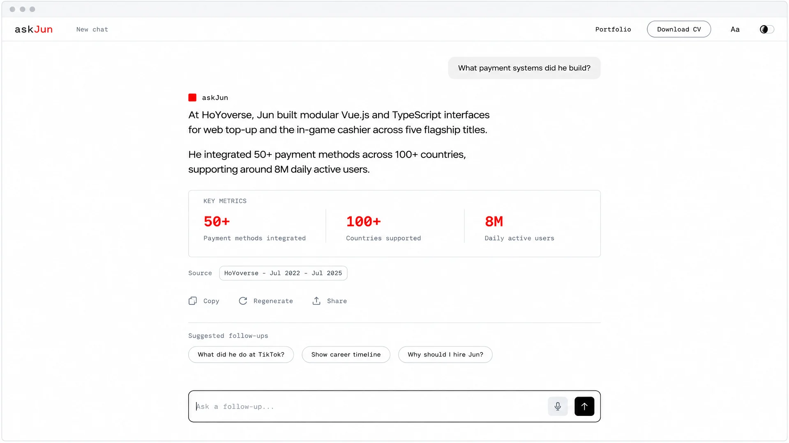
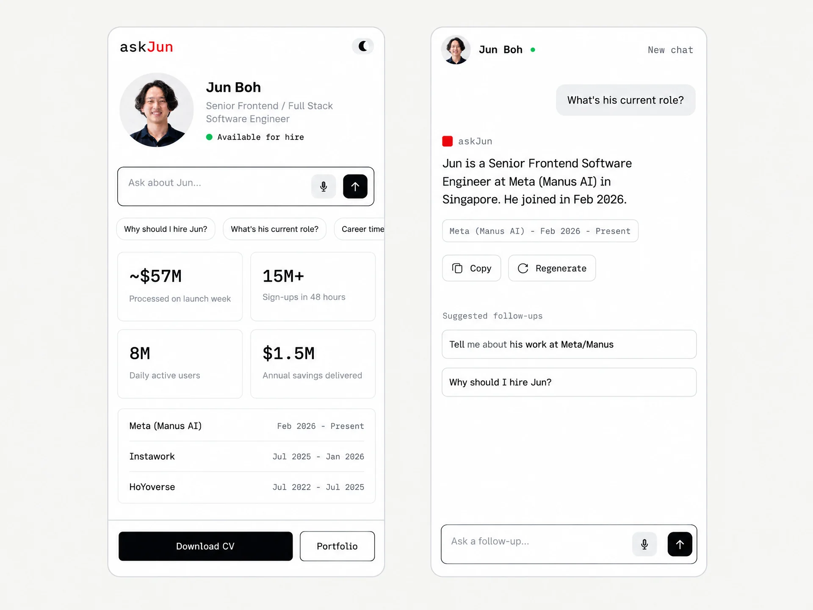

# askJun Redesign Proposals

Date: 17 Nov 2026. Baseline: checkpoint `0e73a474`. Status: **Direction B chosen and built** (see section 6). The detailed build plan is in `plan.md`.

Mockups were generated with `gpt-image-2.5` at high quality (the requested "Fable 5.2" is not offered in this environment, and gpt-image-2.5 was chosen instead). They show layout and tone, not a pixel specification. One mis-rendered letter in the Editorial headline was corrected after generation. The portrait in each is an AI rendering based on the existing header avatar. All copy and numbers in the mockups come from `client/src/data/portfolio.ts`.

## 1. The first-principles question

A recruiter gives the page a few seconds. In that time the page has to do three jobs:

1. **Prove** that Jun is a credible, strong candidate.
2. **Invite** a question, because the chat is what makes this site different.
3. **Hand over** the CV with one click.

Today the page does job 2 well and leaves jobs 1 and 3 to chance. The proof (metrics, employers) only appears after a click, and it disappears from view again once a conversation starts.

## 2. What the audit found

Everything below was checked against the running site and the source at `0e73a474`.

| # | Finding | Evidence | Applies to |
|---|---------|----------|------------|
| 1 | The header avatar is a 3.85 MB, 1920 x 1920 PNG shown at 28 px. It loads on every visit and is served as `application/octet-stream`. | Downloaded via `/manus-storage/header-avatar_6006beaa.png` | Home |
| 2 | Two different portraits of Jun sit on the same screen: the studio avatar in the header and a busier photo in the hero. | Screenshot; `Home.tsx` lines 177 and 243 | Home |
| 3 | No proof on the first screen. Metrics and employers need a chip click or a visit to `/portfolio`. On a 1280 px desktop the lower third of the page is empty. | Screenshot | Home |
| 4 | The same destination has two names: "Experience & Projects" and "Portfolio". There are four links to `/portfolio` on the home page. | `Home.tsx` | Home |
| 5 | Text is very small. Home uses 9, 10 and 11 px labels in 17 places; the portfolio page body text is 11 px. | `Home.tsx`, `index.css` `.scaled-body` | Both |
| 6 | Contrast: the brand red passes on pure white, but several variants fail the 4.5:1 AA threshold (table below). | Computed from `index.css` tokens | Both |
| 7 | Engineering internals are shown to recruiters: "instant / AI / cached" badges, and a tooltip stating "Generated by GPT-4.1-mini ... via LangGraph". With the model fallback chain that statement is not always true, and it cuts across the rule that the assistant presents itself as askJun. The footer also says "built with ... gpt-4". | `Home.tsx` lines 440-448 and 657 | Chat |
| 8 | Pressing Escape wipes the whole conversation with no confirmation. | `Home.tsx` line 101 | Chat |
| 9 | The "GitHub" link goes to the `askjun` repository, not to Jun's profile. | `portfolio.ts` line 39 | Both |
| 10 | The portfolio page is one long column of nine fully expanded sections with CV-length bullets, and its four headline metrics are rendered at 14 px. | `Portfolio.tsx` | Portfolio |

### Contrast measurements

| Pair | Ratio | AA for normal text (4.5:1) |
|------|-------|----------------------------|
| Red `#E60000` on white | 4.81 | Pass |
| Red on card grey `#F7F7F5` | 4.49 | Fail, marginally |
| Red at 70% opacity on white (the "✦" chips) | 3.62 | Fail |
| Placeholder text (muted grey at 50%) on white | 2.27 | Fail |
| Footer text (muted grey at 40%) on card grey | 1.85 | Fail |
| Red on dark background `#0A0A0A` | 4.11 | Fail |
| Red on dark card `#141414` | 3.83 | Fail |

This changes the deferred todo item about red contrast. The brand red does not need to change in light mode. The failures come from opacity variants and from dark mode. Using full-strength red for text, keeping red text off the grey card surface, and switching dark mode to a lighter red such as `#FF4D4D` (6.05 on `#0A0A0A`, 5.63 on `#141414`) resolves it without touching the light-mode identity.

## 3. The four directions

All four keep the chat-first idea, the light Nothing-style palette, the red accent and the existing fonts.

### A. Signal: the refined evolution

The current layout, tightened. One portrait, a header cut to three items, a larger input, one row of chips, then a proof strip and an employer line that fill the empty lower third.

- **Good for:** lowest risk; it is mostly a rework of the empty state in `Home.tsx`.
- **Weakness:** the proof strip is part of the empty state, so it disappears as soon as a conversation starts, exactly as today.
- **Needs:** a dot-matrix display font for the four numbers. Nothing's own typeface is proprietary, so an open alternative has to be chosen and self-hosted.

### B. Split Dossier: proof that stays put

Two panes. The left is a permanent dossier: portrait, title, four metrics, the six-employer timeline, and the CV button. The right is the chat.

- **Good for:** it is the only direction where proof and the CV button stay visible during the conversation, so all three jobs are done at every moment.
- **Weakness:** less white space, so it reads a little less "Nothing". The left pane needs a collapse rule between tablet and desktop widths.
- **Bonus:** the timeline rows and metric tiles can act as prompts (click "HoYoverse" to ask about it).

### C. Bento Ask: every tile is an answer

A bento grid with the input as the largest tile. Every other tile is a fact that can be clicked to ask about it.

- **Good for:** the most distinctive look, and a strong demonstration of frontend craft.
- **Weakness:** eight tiles compete with the input for attention, and the grid has no natural shape once a conversation begins. It would need a designed transition into the chat view.

### D. Editorial: the magazine cover

Very large type, a big portrait, numbered highlights, and the chat reduced to a docked black ask bar.

- **Good for:** the strongest first impression and the best use of the portrait.
- **Weakness:** it is the furthest from "chat-first". The input becomes a bar at the bottom rather than the centrepiece, and the "Work / Experience / Contact" navigation is new scope.

### Comparison

| | A. Signal | B. Split Dossier | C. Bento Ask | D. Editorial |
|---|---|---|---|---|
| Proof on first screen | Yes | Yes | Yes | Yes |
| Proof visible during chat | No | **Yes** | No | No |
| CV button visible during chat | Header only | **Always, primary** | Header only | Header only |
| Chat stays the centrepiece | Yes | Yes | Shared with tiles | No |
| Change from today | Small | Medium | Large | Large |
| Relative build effort | Smallest | Medium | Large | Largest |

## 4. Shared pieces (apply to whichever direction is chosen)

### Conversation view

- One centred reading column with larger body text.
- Answer cards (metrics, timeline) sit inline under the text, as the generative components do today.
- Copy, Regenerate and Share become one quiet labelled row instead of 9 px pills.
- The "instant / AI / cached" badges and the model tooltip are removed from the public view.
- A "New chat" button replaces the hidden click-the-logo and Escape behaviours.
- **Source chips are new scope.** The mockup shows a "Source" chip under the answer. The server currently sends only a retrieval type, so this needs a backend change to return which knowledge file an answer drew on.

### Mobile

All four directions collapse to the same mobile layout: identity row, input, one scrolling row of chips, a 2 x 2 metric grid, a short employer list, and a fixed bottom bar where "Download CV" is a real button rather than an 11 px text link.

## 5. Recommendation

**Direction B on desktop, with the shared conversation and mobile views.** It is the only option that keeps proof and the CV button on screen while someone is chatting, which is where recruiters will spend their time on this site.

If the priority is to ship quickly with little risk, **Direction A** is the fallback: it fixes the first screen but not the conversation.

C and D are better treated as sources of ideas (clickable fact tiles from C, the large portrait from D) than as the base layout.

## 6. Phased plan

Direction B was built on 17 Nov 2026 following `plan.md`. Status of each phase:

| Phase | Scope | Status |
|-------|-------|--------|
| 0. Quick fixes | Resize and re-encode the header avatar; contrast token fixes including a dark-mode red; raise the minimum text size; one name for the portfolio link; confirm before Escape clears the chat; remove model names from the public UI | Done |
| 1. Foundations | Type scale and spacing tokens; shared components for the ask input, chips and metric tiles | Done |
| 2. Home | The first screen in the chosen direction | Done (Split Dossier) |
| 3. Conversation | Reading column, action row, "New chat", inline answer cards; optional source chips (backend) | Done, without source chips (decision 3 still open) |
| 4. Portfolio page | Larger metrics, shorter scannable roles, same components as the home page | Done |
| 5. Mobile and release | Mobile layout, light and dark checks, Lighthouse, tests, checkpoint, GitHub push | Done, except Lighthouse, which was not re-run |

## 7. Decisions needed

1. Which direction: A, B, C, D, or a blend? **Decided: B.**
2. Should the "GitHub" link point to the profile (`github.com/junnyboi`) instead of the `askjun` repository? **Open; link unchanged.**
3. Are source chips under answers wanted (extra backend work), or should they be left out? **Open; not built.**
4. Keep dark mode with a lighter red, or keep the single brand red and accept the dark-mode contrast shortfall? **Decided: lighter red (`#FF4D4D`) in dark mode.**
